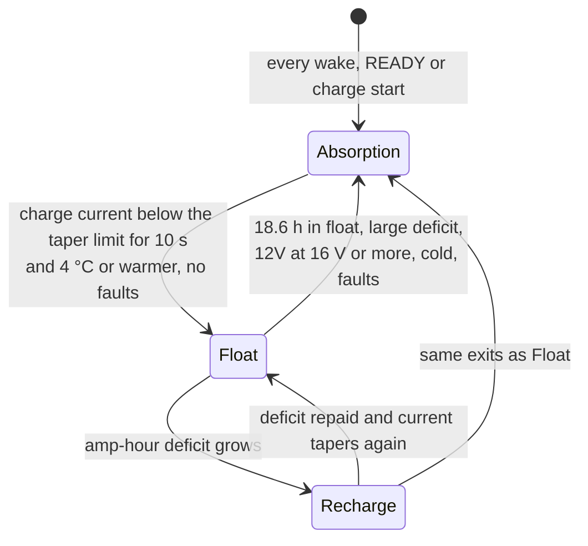
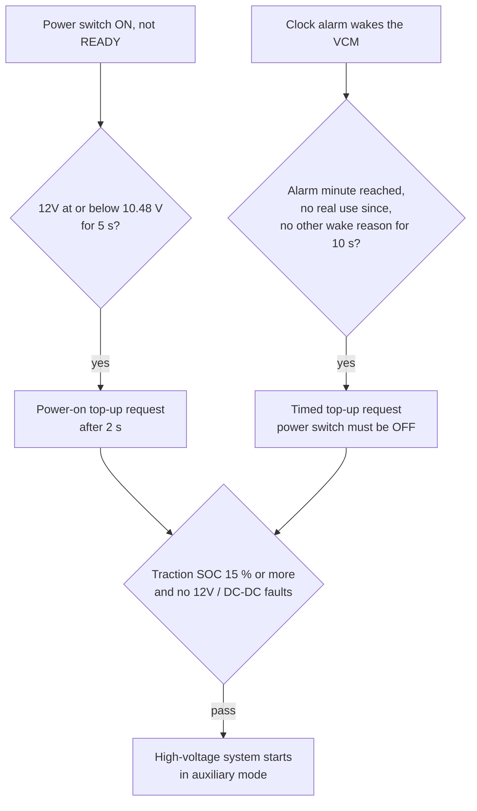

# Nissan Leaf ZE0 (2011–2013): how the VCM charges the 12V battery

This describes the complete 12V charging strategy in the ZE0 vehicle control module (VCM). It
covers driving, plug charging, power-on, and the automatic top-up while parked. It was
reverse-engineered from VCM software **VVM788V38**. Other software versions may use different values.

Every adjustable value is named exactly as it appears in the EcuFlash definition (category
**"12V battery / DC-DC"**), so you can find it there. Voltages in the ROM are stored at 0.08 V per
count; EcuFlash shows them in volts.

---

## 1. Hardware the strategy uses

- **DC/DC converter.** The Leaf has no alternator. The DC/DC converter charges the 12V battery from the
  traction battery, and the VCM tells it what voltage to produce (13.0–15.0 V).
- **12V voltage and current.** The VCM measures the 12V voltage, and the battery's charge/discharge
  current through a current sensor.
- **Temperature.** The voltage tables use the VCM's "temperature sensor 2". It is **not mounted on the battery**.
- **Traction battery SOC.** From the battery controller (CAN 0x55B).
- **Real-time clock.** A separate clock chip keeps time while the car is asleep and can wake the VCM at a set minute.

All timings below come from the VCM's 1.024 ms timer tick.

---

## 2. While driving or plug charging

### 2.1 The stages

| Stage | Voltage | Calibration |
|---|---|---|
| **Absorption** (there is no separate constant-current bulk stage; bulk is simply the start of absorption) | Follows temperature: 14.88 V at −24 °C, 14.40 V at 16 °C, 14.00 V at 48 °C … ≈14.3 V at 25 °C | *12V charge voltage target vs temp (variable-voltage mode off)* |
| **Float** | Fixed **13.04 V** | *12V float voltage (battery judged full, no load request)* |
| **Float with electrical load** | **14.40 V** while the body module signals a load (CAN 0x625), held 61 s after it ends | *12V load-boost voltage (CAN 0x625 load request, 60 s hold)*, *Load-boost enable* |
| **Recharge** (inside float) | Temperature table (stock values identical to absorption) | *12V charge voltage target vs temp (recovery: mode on and charge deficit)* |

### 2.2 When the stages change

**Absorption → Float.** The car decides the battery is "full" with a current-taper test:

- The battery's charge current must be **at or below** a limit from *12V charge-current taper threshold*.
  That's an 8×8 table of temperature × 12V voltage, and its row at 0 °C is zero, so the battery is
  never judged full when cold.
- The current has to stay below that limit for **10.24 seconds**, and the test only runs in READY or charge mode.
- Float then starts if all of these hold:
  - temperature is 4 °C or warmer
  - the amp-hour deficit is not large
  - the 12V is below 16 V
  - no 12V/DC-DC fault is set

**Float → Absorption.** Any one of these:
- **18.6 hours** of float (counted only while the car is on)
- a large amp-hour deficit
- 12V at 16 V or more for 2 s
- below 4 °C, a fault, or leaving READY/charge mode

**Float ↔ Recharge.** While floating, the VCM counts amp-hours in and out of the battery, crediting
charge at 90 % (a charge-efficiency allowance). If the deficit passes a threshold, it switches to the
recharge table. Once the deficit is repaid and the current tapers again, it returns to float and
resets the counter.

**The counter only runs during float.** Energy drawn while parked, or before the battery was judged
full, is never counted.

### 2.3 Turning the target into a command

1. **Target clamps.** The stage voltage is limited by *12V charge voltage ceiling vs temp*. At 100 %
   traction SOC it is at least *12V minimum target at 100 pct SOC*. The result is clamped between
   *12V target minimum clamp* and *12V target maximum clamp* (13.04–14.88 V stock).
2. **Floor request.** Another module (the brake system) requests a minimum voltage over CAN 0x1CB with a
   2-bit level, giving *12V floor level 0* to *12V floor level 3* (13.04 / 13.52 / 13.68 / 14.24 V stock).
   The VCM uses whichever of the target and the floor is **higher**. That's why the 12V sometimes reads
   13.5–13.7 V in float.
3. **Special modes:**
   - If the 12V drops below *Low-12V mode threshold* (12.48 V), the command is capped at *DC-DC target cap in low-12V mode* (14.0 V).
   - With a DC/DC fault it uses *DC-DC target in fault mode*.
   - When the car is awake but not READY or charging it uses *DC-DC target when not READY/charging* (14.0 V).
4. **Closed loop.** The command is ramped smoothly. The VCM then corrects it by up to ±2 V so that the
   voltage it **measures at the battery** matches the target (cable losses are compensated).
5. **Output.** The final value is clamped to *DC-DC command minimum (mV)* / *DC-DC command maximum (mV)*
   (13.0–15.0 V) and converted for the DC/DC converter through *DC-DC voltage command output vs commanded voltage*.

---

## 3. Automatic 12V charge (power-on and parked)

The 2010 service manual describes this as "Automatic 12V Battery Charge Control". This software
implements it with different numbers:

| | Service manual (2010) | VVM788V38 |
|---|---|---|
| Parked interval | 120 h without use | **24 h** after the last real use |
| What counts as use | READY, charging or timer/remote A/C for more than 5 min | READY, charging or a top-up for **4.1 min** or more |
| Top-up length | 5 min | **until the charge current tapers, or 4.1 min**, whichever comes first |
| Not within ~1 h of power ON/OFF | yes | a pending top-up is never closer than **60 min** |

### In short: car off and parked

The DC/DC converter runs from the traction battery, so **charging the 12V while parked always means
switching the high-voltage system on**. There is no low-power way to charge it. A parked top-up goes like this:

1. **The clock wakes the VCM** 24 h after the car was last used for 4.1 minutes or more (§3.1).
2. **No voltage is checked.** The VCM doesn't read the 12V or the traction voltage to decide
   whether to charge. It tops up every time, as long as:
   - traction battery SOC is 15 % or more
   - no 12V/DC-DC fault is stored
   - the power switch is off
   - no other wake reason (charging, climate) is active
3. **High voltage comes on** through the normal precharge and main-relay sequence (§3.3), and the
   third charge LED blinks.
4. **It charges at absorption voltage** (the temperature table, ≈14.3 V at 25 °C). There's no
   float stage and no amp-hour counting.
5. **It stops** when the charge current falls below a set level, or after **4.1 minutes**, whichever
   comes first (§3.5).
6. **High voltage goes off**, the alarm is set for **another 24 h**, and the VCM sleeps.

**The only voltage-triggered charge happens at power-on.** With the power switch ON but not READY,
if the 12V reading is **10.48 V or lower for 5 seconds**, the VCM starts the same top-up (§3.2).
While parked and off, a low 12V is **not** detected. Nothing wakes the car because the 12V is low;
only the clock does.

### 3.1 It's a clock, not a voltage, that wakes the car

**No 12V voltage level wakes the car.** While asleep the VCM does nothing. Before sleeping, it sets
an alarm on the real-time clock for the **earliest** pending event: timer charging, climate timers, or
the next 12V top-up. The clock wakes the VCM at that minute.

The 12V top-up alarm is set like this:
- after any **real use** (4.1 min or more of READY, charging or a top-up): **now + 24 h**
  (*Auto 12V top-up: interval from last use to next timed top-up*, and *Auto 12V top-up: interval, second re-arm case*)
- if the alarm would be less than 60 min away, it's pushed to now + 60 min
  (*Auto 12V top-up: minimum gap before a pending top-up*)
- short uses (under 4.1 min) don't move the alarm

### 3.2 The two triggers

- **Power-on check:** with the power switch ON (not READY), the 12V at or below **10.48 V** for 5 s starts a top-up.
- **Timed top-up:** at the alarm minute, with the power switch OFF, the car starts a top-up.
- **Both need** traction battery SOC **15 % or more** and no 12V/DC-DC fault. The 15 % limit is fixed
  in the software, not a calibration.

### 3.3 Starting the high-voltage system

The VCM uses **one high-voltage start-up sequence** for READY, plug charging and the auxiliary mode.
The relays are in the Li-ion battery junction box: system main relay 2, the precharge relay (in series
with a precharge resistor), and system main relay 1.

| Step | What happens | To move on |
|---|---|---|
| 1–3 | Main relay 2 and the precharge relay close; the inverter's capacitor charges through the resistor | three short timed steps (about 0.1 s in total) |
| 4 | **Precharge** | the inverter reports "HV ready" **and** inverter and battery voltage agree; at least 0.3 s |
| 5 | Main relay 1 closes, the precharge relay opens | 0.1 s |
| 6 | HV confirmed | the HV-established signal is held for 0.3 s |
| run | READY / charging / **auxiliary mode** | |

If precharge doesn't complete within **5.1 seconds**, the VCM sets **P3176** ("traction motor inverter
condenser: pre-charging cannot be performed for 5 seconds or more") and aborts the start-up.

The relay order is from the service manual. The VCM steps were matched to it; the individual relay
outputs weren't traced.

**Auxiliary mode** is the high-voltage-on state used when something needs HV without READY or
plug charging. It serves the **automatic 12V top-up** and **climate control** (the climate request has
a 15-minute window, matching remote climate's run time). Only the 12V top-up makes the third charge LED blink.

### 3.4 During the top-up

- The **third charge LED blinks** on its own (about 1 s on, 1 s off).
- The DC/DC charges at **absorption voltage** (≈14.3 V at 25 °C, from the temperature table). Float
  never applies in this mode.
- The amp-hour counter does not run.

### 3.5 Ending the top-up

Whichever comes first:
1. **The current tapers.** Charge current below *Auto 12V top-up: ends when 12V charge current raw is
   below this* for 0.1 s.
2. **4.1 minutes pass.** *Auto 12V top-up: use time that counts as a drive/charge and max top-up length*
   = 2400 × 0.1024 s. This also re-arms the alarm for another 24 h.
3. **The power button is pressed.** The high-voltage system is handed straight to READY, with no new precharge.

The VCM then opens the contactors, waits for the high voltage to discharge, and goes back to sleep.

### 3.6 What that means for the battery

At most ~4 minutes of charging per day returns roughly 1.5–2 Ah, about what the car can draw while
parked in a day. The top-up slows the decline but doesn't recharge a run-down battery.

---

## 4. Why ZE0 12V batteries fail early

1. **The "full" test is too quick.** Right after start-up a lead-acid battery's charge current drops
   within seconds because of surface charge. Sulfated, aged or cold batteries also accept little
   current. All of these pass the 10-second taper test early, and the car drops to float after minutes
   of absorption.
2. **Float is too low.** Lead-acid needs **13.5–13.8 V** of float to stay at 100 % and resist
   sulfation. 13.04 V is barely above the battery's resting voltage, so it hardly charges at all.
3. **Parked drain is never counted.** The amp-hour counter only runs in float.
4. **Refresh charging is rare.** Float lasts up to 18.6 h of on-time before the car re-absorbs, which
   at 1–2 h of driving a day means every 1–3 weeks.

The battery lives partly charged, sulfates, and loses capacity. That speeds up the same cycle.

---

## 5. What can be changed

All of these are calibration values in the EcuFlash definition. Correct the ROM checksums after any edit.

### Lead-acid (flooded / AGM)

| EcuFlash name | Stock | Suggested | Why |
|---|---|---|---|
| *12V float voltage (battery judged full, no load request)* | 13.04 V | **13.60 V** (AGM 13.68 V) | real float |
| *12V minimum target at 100 pct SOC* | 13.04 V | same as float | consistency |
| *12V target minimum clamp (also CAN floor minimum)* | 13.04 V | same as float | nothing drops below float |
| *12V charge-current taper threshold* | stock | **half of every cell** | longer absorption before "full" |
| *12V charge voltage target vs temp (variable-voltage mode off)* and *(recovery …)* | 14.88 14.80 14.40 14.00 13.60 13.20 13.12 13.04 | 14.88 14.88 14.64 14.24 13.76 13.44 13.28 13.20 (AGM: cap the cold end at 14.72) | ≈14.6 V at 25 °C |
| *12V charge voltage ceiling vs temp* | 14.88 14.88 14.88 14.80 13.60 13.20 13.04 13.04 | 14.88 14.88 14.88 14.80 13.76 13.44 13.28 13.20 | stays at or above float when hot |
| *Auto 12V top-up: interval from last use to next timed top-up* and *Auto 12V top-up: interval, second re-arm case* | 1440 min | **720 min** | top up twice a day while parked |
| *Auto 12V top-up: use time that counts as a drive/charge and max top-up length* | 2400 (4.1 min) | **9375 (16 min)** | longer parked top-ups |
| *Auto 12V top-up: ends when 12V charge current raw is below this* | 0x8100 | 0x8040 | top-up ends at a lower current |

### LiFePO4 (LFP)

| EcuFlash name | Suggested |
|---|---|
| Both *12V charge voltage target vs temp* tables | 13.44 13.44 14.00 14.08 14.08 14.00 13.76 13.60 V (no cold boost) |
| *12V charge voltage ceiling vs temp* | 13.44 13.44 14.16 14.16 14.16 14.08 13.76 13.60 V |
| *12V target maximum clamp* | 14.16 V |
| *12V floor level 0* to *12V floor level 3* | 13.44 13.44 13.44 13.60 V |
| *12V load-boost voltage* | 14.00 V |
| *12V float voltage*, *12V minimum target at 100 pct SOC*, *12V target minimum clamp* | 13.44 V (or keep 13.04 V for a lower storage charge) |
| *12V charge-current taper threshold* | leave stock |

Use an LFP battery made for vehicle charging, with its own BMS that **blocks charging below 0 °C**.
The VCM's temperature sensor isn't on the battery.

### Things to know before changing anything

- **The use-time value does two jobs.** *Auto 12V top-up: use time that counts as a drive/charge and max top-up length* sets both the top-up length and
  how long a drive must be to re-arm the 24 h alarm.
- **Each parked top-up runs the HV system.** That costs a little traction energy and cycles the
  contactors, so shorter intervals mean more contactor cycles.
- **The current sensor scale is unknown.** The taper threshold and the top-up end current are in raw
  sensor units, so change them in small steps.
- **Check your software version.** Values here are for VVM788V38; other builds (for example later
  2013 cars) may use different values or locations.
- **These values haven't been tested on a car.** They are standard charging practice applied to the
  factory logic. Log the commanded 12V voltage before and after flashing, and keep the original ROM.

---

## 6. Not yet known

- the scale (amps per count) of the 12V current sensor
- **the power-switch signal:** the flag that separates the power-on check from the parked top-up is taken
  to be "power switch ON" from how the software uses it (READY and diagnostics require it too). Its
  input wasn't traced.
- **the 12V reading:** which input feeds the 12V reading used by the charge logic and the 10.48 V check
  (it's separate from the VCM's own supply-voltage reading)
- which relay output switches at each start-up step
- one of the three sources that can request auxiliary HV mode
- how the alarm is written to the clock chip, and which pin wakes the VCM
